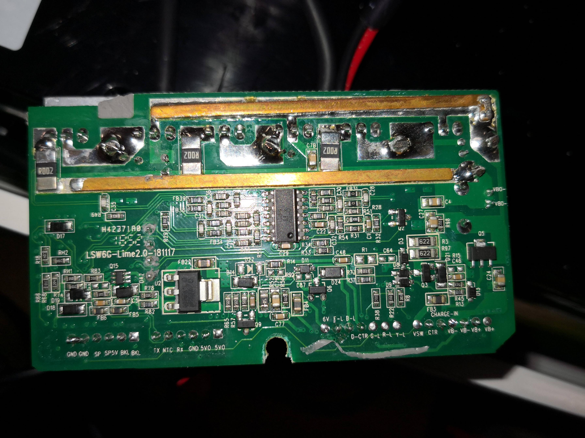

# KAMAIKASHI Sensorless ESC

Experimental firmware and hardware notes for an **STM32F103C8T6** scooter ESC with **FD2103S** gate drivers.

[Polski](README.pl.md) · [Current sketch](main/CUSTOM_FIRMWARE_ESC.ino) · [Setup and UART controls](docs/FIRMWARE.md) · [Hardware reference](docs/HARDWARE.md)

## Current firmware

The main sketch implements **open-loop sinusoidal drive** and a **BEMF zero-cross monitor**. Zero-cross readings are telemetry only; closed-loop sensorless commutation remains a development goal.

| Part | Current implementation |
| --- | --- |
| Bridge | TIM1 complementary 6PWM, 20 kHz |
| Control | Open-loop frequency/modulation ramps |
| Measurements | BEMF A/B/C, low-side current-sense ADC and VBAT |
| Interface | UART at **38400 baud**, PB6 TX / PB7 RX |
| Stop modes | Freewheel and a software emergency-off command |

This is bench-development firmware. Use a current-limited supply, keep the wheel clear and provide a physical power cutoff. The main sketch does not implement a complete overcurrent, undervoltage or thermal fault layer.

## Files to use

| File | Purpose |
| --- | --- |
| [main/CUSTOM_FIRMWARE_ESC.ino](main/CUSTOM_FIRMWARE_ESC.ino) | Current open-loop drive and ZC-monitor sketch |
| [experimental/6pwm_bridge_test.ino](experimental/6pwm_bridge_test.ino) | Complementary PWM and per-phase hard-OFF tests |
| [experimental/open_loop_sinusoidal_test.ino](experimental/open_loop_sinusoidal_test.ino) | Earlier sinusoidal-drive experiment |
| [experimental/alt_test_firmware.ino](experimental/alt_test_firmware.ino) | Alternative bridge/startup experiments |
| [WhatWeHave.txt](WhatWeHave.txt) | Archived board findings and commutation notes |

Read the [firmware guide](docs/FIRMWARE.md) for sketch setup, UART keys and the differences between experimental files. Pin maps, driver polarity and calibration notes are in the [hardware reference](docs/HARDWARE.md).

[View the second board photo](lime3-2.jpg)
