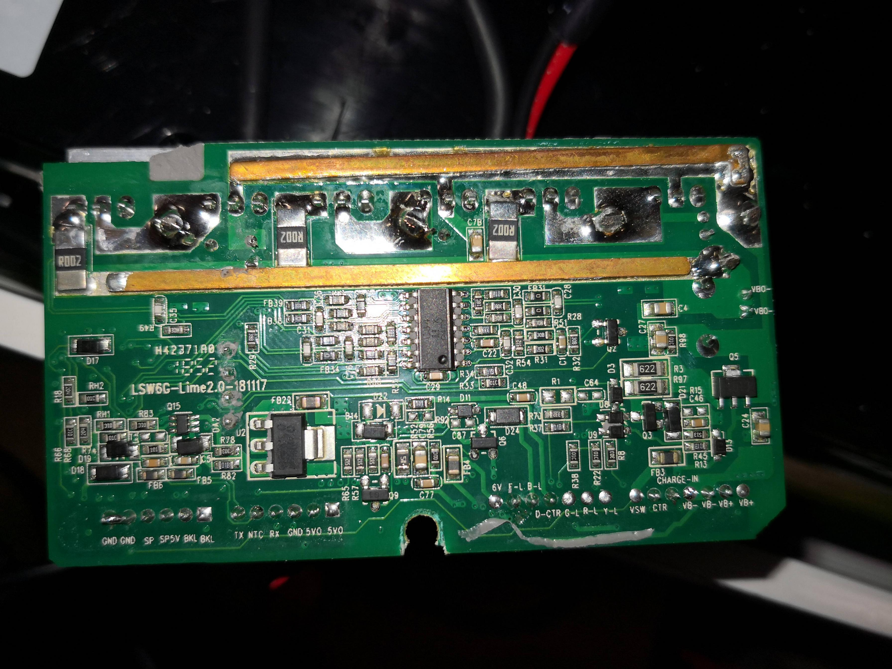

# KAMAIKASHI Sensorless ESC

Eksperymentalny firmware i dokumentacja sterownika BLDC z **STM32F103C8T6** oraz driverami **FD2103S**.

[English](README.md) · [Aktualny szkic](main/CUSTOM_FIRMWARE_ESC.ino) · [Uruchomienie i UART](docs/FIRMWARE.md) · [Piny i sprzęt](docs/HARDWARE.md)

## Obecny stan

Główny szkic steruje silnikiem sinusoidalnie w **otwartej pętli**. Korzysta z TIM1 i komplementarnego 6PWM przy 20 kHz. Monitoruje BEMF, sygnały boczników, VBAT i przejścia przez zero.

Monitor ZC służy obecnie do telemetrii. Zamknięta pętla sensorless pozostaje celem rozwoju. UART: **38400 baud**, PB6 TX / PB7 RX.

To firmware do prób stanowiskowych: zasilacz z ograniczeniem prądu, uniesione koło i fizyczne odcięcie zasilania. Główny szkic nie zawiera kompletnej warstwy zabezpieczeń prądowych, podnapięciowych i termicznych.

## Gdzie zacząć

- [main/CUSTOM_FIRMWARE_ESC.ino](main/CUSTOM_FIRMWARE_ESC.ino) — aktualny szkic.
- [experimental/](experimental/) — osobne próby mostka i rozruchu.
- [docs/FIRMWARE.md](docs/FIRMWARE.md) — przygotowanie szkicu, komendy i parametry.
- [docs/HARDWARE.md](docs/HARDWARE.md) — mapa pinów, stan OFF i pomiar prądu.
- [WhatWeHave.txt](WhatWeHave.txt) — archiwalny zapis ustaleń sprzętowych.

