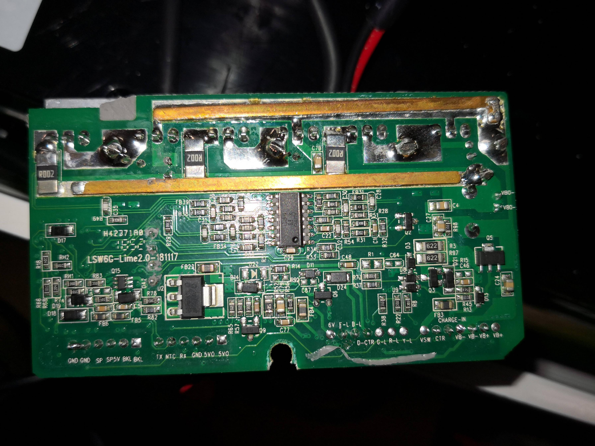
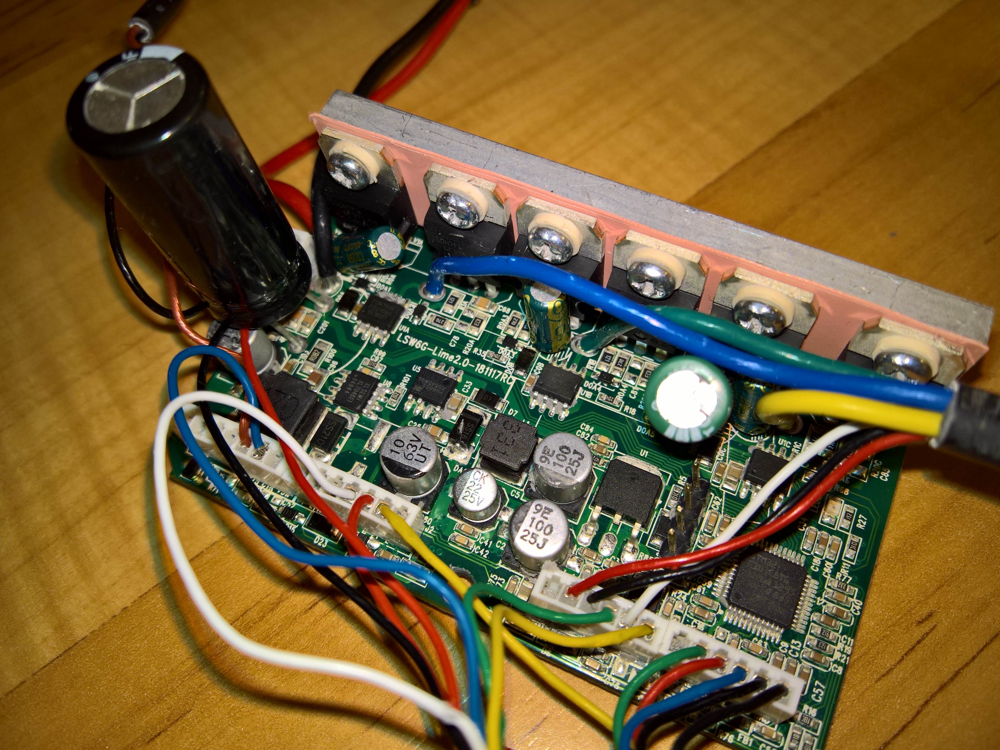

# Hardware reference

[Project](../README.md) · [Firmware guide](FIRMWARE.md) · [Archived findings](../WhatWeHave.txt)

The tables below preserve the original reverse-engineered board assignments. PA3 throttle, PB0 NTC, PB1 brake and the auxiliary GPIO labels describe board findings; the current main sketch samples BEMF, current-sense inputs and VBAT and accepts its control commands over UART.

## Hardware platform

### MCU

* **STM32F103C8T6**

### Gate drivers

* **FD2103S x3**

### PWM power stage

| MCU Pin | Function |
| ------- | -------- |
| PA8     | HIN_A    |
| PA9     | HIN_B    |
| PA10    | HIN_C    |
| PB13    | LIN_A    |
| PB14    | LIN_B    |
| PB15    | LIN_C    |

### ADC / sensing

| MCU Pin | Signal        |
| ------- | ------------- |
| PA0     | BEMF_A        |
| PA1     | BEMF_B        |
| PA2     | BEMF_C        |
| PA3     | Throttle / SP |
| PA4     | IA            |
| PA5     | IB            |
| PA6     | IC            |
| PA7     | VBAT          |
| PB0     | NTC           |

### UART

| MCU Pin | Signal |
| ------- | ------ |
| PB6     | TX     |
| PB7     | RX     |

### Other discovered GPIO

| MCU Pin | Function       |
| ------- | -------------- |
| PB1     | Brake          |
| PB2     | Status LED     |
| PB4     | DisplayControl |
| PB9     | Back Light     |
| PB11    | Front Light    |

## Important engineering findings

### Safe OFF state

A major practical finding of this project:

> disabling TIM1 PWM alone is **not always enough** for a true OFF bridge state.

Reliable inactive phase OFF required GPIO forcing:

* **HIN = LOW**
* **LIN = HIGH**

This fully solved the observed **low-side MOSFET sticking behavior** during bench tests.

### Current sense behavior

The board uses **low-side shunt current sensing**.

This means current interpretation is:

* commutation-sector dependent
* valid only when the return low-side path is conducting
* not equal to permanent true phase-current measurement

This is critical for future:

* overcurrent protection
* torque estimation
* startup fault detection
* current limiting

### VBAT scaling and archive differences

VBAT measurement is implemented through a resistor divider.

The final scaling factor should always be **bench-calibrated against real supply voltage**, because divider assumptions may differ between board revisions.

The current main sketch uses `VBAT_DIV = 30.1f`. The archived notes record an empirical `VBAT_SCALE = 31.1f`. These belong to different development snapshots and are not interchangeable calibration guarantees.

## Current-sense observations

The original resistor-based tests associated the strongest readout with the return low-side path:

| Test sector | Strongest readout |
| --- | --- |
| A+ / B− / C floating | IB |
| B+ / C− / A floating | IC |
| C+ / A− / B floating | IA |

The current main sketch reports ADC-derived signals. It does not provide a calibrated phase-current measurement in amperes or a complete current-limit loop.

## Debug access

Keep PA13 SWDIO and PA14 SWCLK available. The sketches disable JTAG while preserving SWD. No separate global gate-driver enable line is confirmed in the archived board notes.

## Board photos

